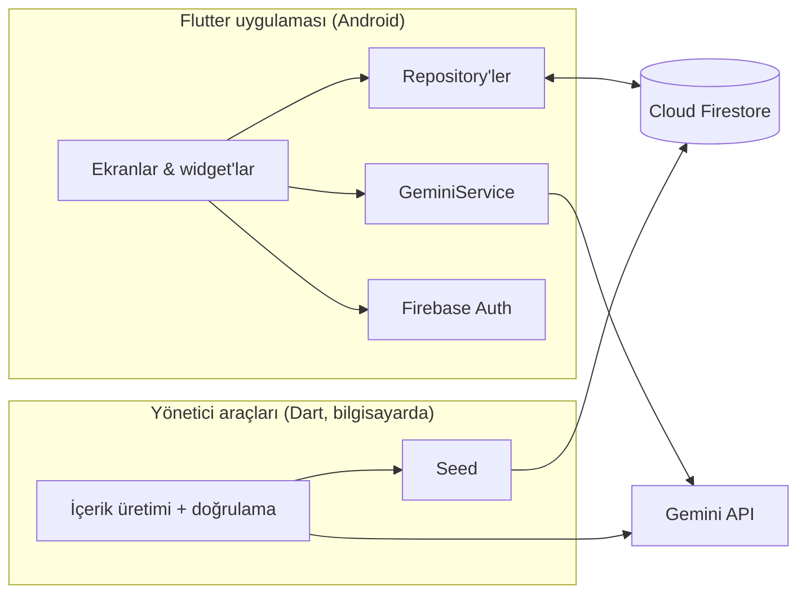

<div align="center">

# 🎓 Öğrenme Asistanı

**YKS'ye hazırlanan öğrenciler için yapay zekâ destekli, Flutter ile geliştirilmiş mobil çalışma asistanı**

TYT · AYT · YDT müfredatını ders, ünite ve konu konu takip et; her konuda hafıza kartı ve test çöz; yapay zekâ öğretmene soru sor, fotoğrafını çektiğin soruyu çözdür.


</div>

---

## ✨ Öne çıkanlar

| | |
|---|---|
| 🗺️ **YKS Müfredatı** | 23 ders yolu, 177 ünite ve 550'den fazla konu. Ünite/konu adları MEB'in resmî "TYT-AYT-YDT kazanım ve açıklamalar" belgesine göre hazırlandı. |
| 🧠 **4 içerik tipi** | Her konuda hafıza kartı, çoktan seçmeli test, boşluk doldurma ve doğru/yanlış. 518 konuda hazır içerik var; TYT Biyoloji tam kapsamlı. |
| 💬 **AI öğretmen** | Gemini ile bağlamı koruyan, yanıtları akış hâlinde gösteren sohbet. Fotoğraf çekip kırparak sorunu sor, çözümünü gör. |
| 🃏 **Kendi setini üret** | Bir metni ya da PDF'i yükle; istediğin sayıda kart veya 3 farklı formatta test üretilsin. |
| 🎯 **Motivasyon** | Sınav geri sayımı, günlük çalışma serisi, otomatik açılan başarım rozetleri, konu ilerleme halkaları. |
| ☁️ **Hesap & senkronizasyon** | Google ya da misafir girişi; tüm veriler Cloud Firestore'da, cihaz değişse de kaybolmaz. |
| 🎨 **Modern arayüz** | Gradyan tema, açık/koyu mod, ders başına renk ve ikon kimliği, animasyonlu açılış. |

> ⚠️ **Not:** Konulardaki kart ve sorular, resmî MEB müfredat başlıklarına dayanarak yapay zekâ ile üretilmiştir; belirli bir yayınevinin kitabından ya da soru bankasından alınmamıştır. Çalışma amaçlı örnek içeriktir, resmî kaynak yerine geçmez.

<!--
## 📱 Ekran görüntüleri
Görüntüleri docs/screenshots/ klasörüne koyup bu yorumu kaldırın:

| Ana Sayfa | Müfredat | Ders Yolu | Test |
|---|---|---|---|
|  |  |  |  |
-->

---

## 🧭 Nasıl çalışır?



1. **Giriş:** `AuthGate`, oturumu dinler; giriş yoksa giriş ekranı, ilk girişte asistan karakteri seçimi, sonra ana ekran.
2. **Müfredat:** Ders listesi ve konu haritası, herkese açık `curriculum_paths` koleksiyonundan okunur. Bir konunun içeriği ilk açıldığında kullanıcının kendi kart/test koleksiyonuna kopyalanır, böylece mevcut kart ve test ekranları aynen yeniden kullanılır.
3. **İlerleme:** Her konunun dört içerik türü küçük parçalara bölünmüştür; bir tür, tüm parçaları tamamlanınca biter, dört tür bitince sıradaki konunun kilidi açılır. İlerleme `users/{uid}/path_progress` altında saklanır.
4. **Yapay zekâ:** Sohbet, akış (SSE) ile gelen yanıtı canlı gösterir; kart/test üretimi `responseSchema` ile JSON'a zorlanır, çıktı doğrulanıp elenir. PDF ve fotoğraflar çok kipli (multimodal) istekle gönderilir.

## 🤖 İçerik üretim hattı

Müfredat içeriği elle yazılmadı; `tool/` altındaki Dart araçlarıyla üretildi, doğrulandı ve Firestore'a aktarıldı:

```
yks_outline.txt  ──►  generate_lite_content  ──►  doğrulama / onarım  ──►  seed_content_admin  ──►  Firestore
(müfredat taslağı)    (Gemini, konu başına 1 istek)   (otomatik kalite kontrolleri)   (servis hesabı)
```

- **Hız ve kota yönetimi:** istek sınırlayıcı, kaldığı yerden devam eden üretim, günlük kota dolunca temiz durma.
- **Kalite güvencesi:** yapı kontrolü, benzer soruların elenmesi, doğru şıkkın dağılımının dengelenmesi, bozuk karakter ve **Türkçe harf kaybı** tespiti ve güvenli onarımı (yalnızca ASCII'ye çevrildiğinde orijinalle birebir aynı olan düzeltmeler kabul edilir).
- **Bağımsız doğrulama:** Matematik, Geometri, Fizik ve Kimya'da model soruları cevapsız şekilde baştan çözer; kendi cevabıyla uyuşmayan sorular silinir.
- **Maliyet kontrolü:** ortak harcama sayacı; bütçe aşılacaksa istek başlamaz.

## 🛠️ Teknolojiler

| Katman | Teknoloji |
|---|---|
| Uygulama | Flutter (Dart ^3.12), Material 3 |
| Kimlik & veri | Firebase Authentication (Google, anonim), Cloud Firestore |
| Yapay zekâ | Google Gemini API (`gemini-flash-lite`): akışlı sohbet, yapılandırılmış JSON çıktısı, PDF/görüntü girdisi |
| Paketler | `http`, `flutter_dotenv`, `google_sign_in`, `flutter_markdown_plus`, `image_picker`, `image_cropper`, `file_picker`, `shared_preferences` |
| Araçlar | Dart betikleri, `googleapis_auth` (Firestore yönetici erişimi), Python (Pillow, PyMuPDF) |

## 📁 Proje yapısı

```
lib/
├── screens/     28 ekran: sohbet, kartlar, testler, müfredat, ders yolu, profil, ayarlar …
├── models/      19 veri sınıfı (fromJson/toJson)
├── services/    Gemini servisi, repository'ler (Firestore), kimlik doğrulama, tema/ayar kontrolcüleri
├── widgets/     Tekrar kullanılabilir bileşenler (kart çevirme, rozetler, seçiciler)
├── theme/       Gradyan tema ve sayfa geçişleri
└── config/      Ders renk/ikon kimlikleri, geliştirici bayrakları
tool/            İçerik üretimi, doğrulama, onarım ve Firestore aktarım araçları
scripts/         Logo üretimi, otomasyon betikleri
test/            Birim testleri (ilerleme ve model mantığı)
```

## 🚀 Kurulum

**Gereksinimler:** Flutter SDK (Dart ^3.12), bir Android cihaz/emülatör, kendi Firebase projeniz (Authentication → Google + Anonim, Cloud Firestore) ve bir [Gemini API anahtarı](https://aistudio.google.com/).

```bash
git clone https://github.com/MelihAliCagman/ogrenme-asistani.git
cd ogrenme-asistani
flutter pub get

cp .env.example .env          # GEMINI_API_KEY değerini yazın
flutterfire configure         # kendi Firebase projenizi bağlayın
flutter run
```

Kontroller: `flutter analyze` · `flutter test`

Müfredat verisi herkese açık `curriculum_paths` koleksiyonundadır; kendi projenizde doldurmak için `tool/` altındaki aktarım araçları (bir servis hesabı anahtarı gerekir) kullanılabilir.

## 🔐 Güvenlik notları

- `.env` ve servis hesabı anahtarı `.gitignore` ile depodan hariç tutulur.
- Gemini anahtarı geliştirme kolaylığı için `.env` ile uygulamaya paketlenir; **yayına almadan önce yapay zekâ çağrıları bir sunucu tarafına (ör. Cloud Functions) taşınmalı** ve kullanıcı başına kullanım sınırı konmalıdır.
- Firebase istemci yapılandırması (`firebase_options.dart`) gizli bilgi değildir.

## 🗺️ Yol haritası

- [ ] Yapay zekâ çağrılarının sunucu tarafına taşınması ve kullanıcı başına kota
- [ ] Hesaplı derslerde içeriğin bir öğretmen tarafından gözden geçirilmesi
- [ ] Kullanıcı geri bildirimiyle ("hatalı soru bildir") soru kalitesinin ölçülüp iyileştirilmesi
- [ ] Kalan konuların içeriği, ders ve konu bazında arama
- [ ] Widget/entegrasyon testleri ve CI
- [ ] Bildirimler (günlük çalışma hatırlatıcısı)

## 👤 Geliştirici

**Melih Ali Çağman**, [@MelihAliCagman](https://github.com/MelihAliCagman)
